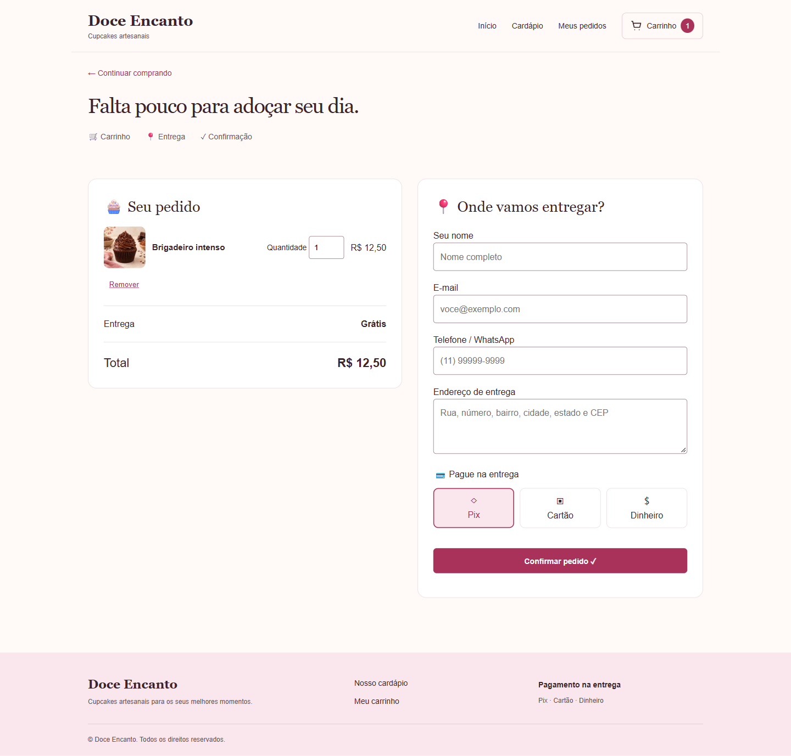
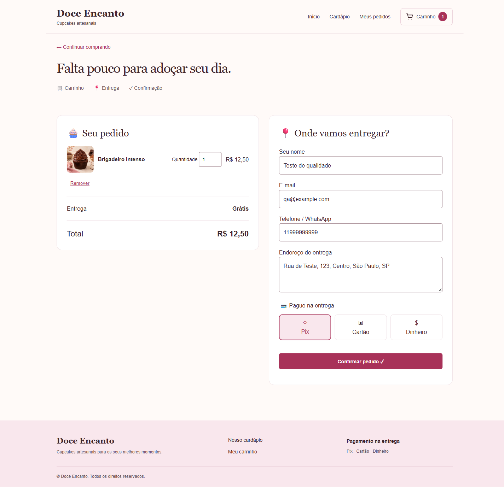
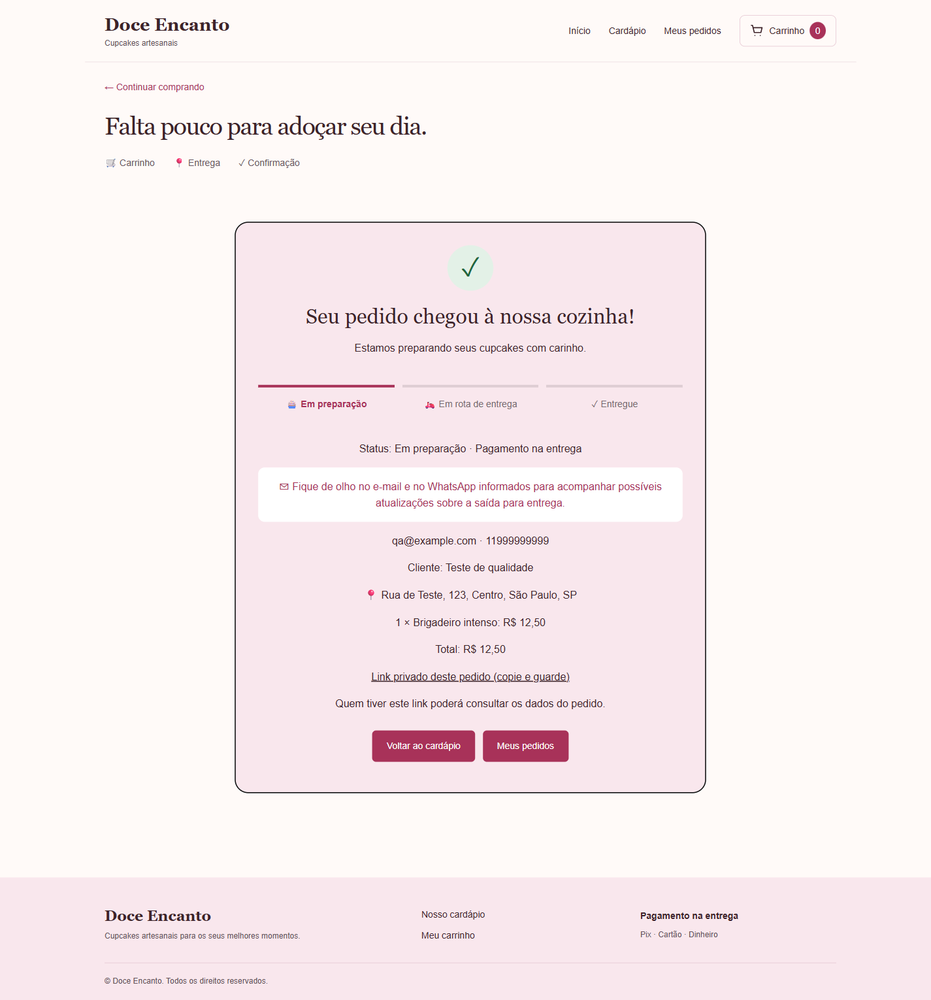
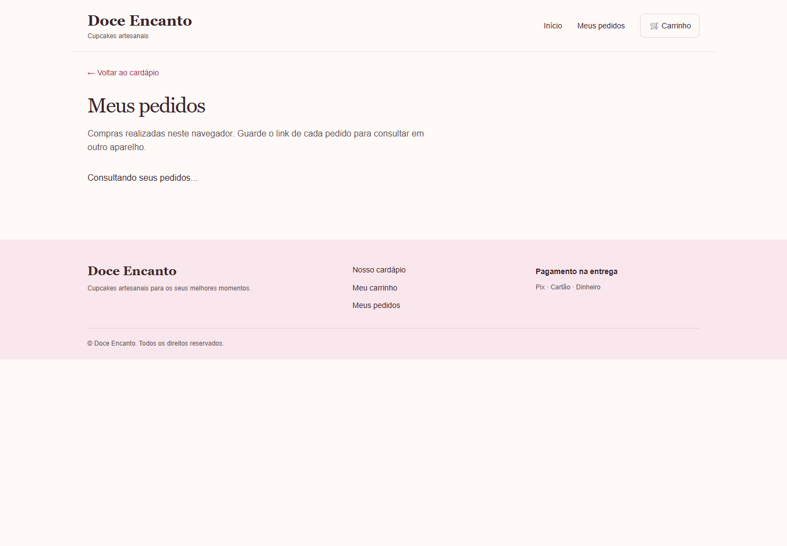

# Laudo de qualidade — Doce Encanto

**Responsável pelo projeto:** Matheus da Silva Mattos  
**RGM:** 36338770  
**Data da avaliação interna:** 29/10/2026  
**Aplicação:** https://doce-encanto-simples.onrender.com

## Objetivo

Verificar o funcionamento do fluxo de compra e registrar as correções realizadas para melhorar a utilização do sistema.

## Procedimentos

Foram realizadas verificações internas do catálogo, carrinho, formulário, confirmação, consulta de pedidos e navegação responsiva. Também foram executados sete testes automatizados de validação. O responsável pelo projeto informou ter concluído o fluxo final com sucesso.

## Problemas encontrados e correções

| Registro | Problema observado | Correção realizada | Resultado |
| --- | --- | --- | --- |
| QA-01 | A inclusão abria o fechamento imediatamente e o catálogo repetia imagens. | Manter o cliente no catálogo e reduzir para três sabores com fotos diferentes. | Seleção de vários sabores sem interrupção; catálogo organizado. |
| QA-02 | Carrinho junto ao catálogo, sem fotos dos itens. | Criar página própria com miniaturas, quantidades, remoção e resumo. | Carrinho mais claro, com total atualizado e persistência no navegador. |
| QA-03 | Ausência de e-mail e telefone e apresentação pouco clara dos pagamentos. | Adicionar validação dos contatos e opções Pix, cartão e dinheiro na entrega. | Dados obrigatórios validados e pagamento selecionável. |
| QA-04 | Ausência de histórico e apresentação insuficiente do andamento. | Criar Meus pedidos, links privados e etapas visuais com Em preparação ativa. | Cliente consegue localizar e consultar suas compras neste navegador. |
| QA-05 | Atalho de pedidos fora do menu e excesso de textos na interface. | Integrar o acesso ao menu, reorganizar rodapé e reduzir textos. | Navegação mais direta e melhor organização visual. |

## Resultados técnicos

A aplicação publicada respondeu às consultas das páginas de catálogo, carrinho e pedidos. O banco retornou três produtos ativos e preservou um pedido anterior. O registro de pedidos, a consulta por link privado, o cálculo do total no servidor e as respostas a dados inválidos e pedido inexistente foram verificados. Os sete testes automatizados de validação passaram sem falhas.

## Limites verificados

O status permanece Em preparação conforme o escopo definido. E-mail e WhatsApp são armazenados, mas não há envio automático de mensagens. O histórico depende deste navegador; o link privado permite consultar o pedido em outro aparelho. Não foi registrada uma verificação controlada após reinício manual do serviço ou uma avaliação exaustiva de navegadores.

## Conclusão

As correções melhoraram o fluxo de escolha, fechamento e consulta de pedidos. A versão atende ao escopo implementado de catálogo, carrinho, pagamento na entrega e registro persistente de pedidos. Os resultados apresentados correspondem às verificações internas registradas, respeitando os limites descritos.

## Evidências da versão final

Capturas realizadas no site publicado em 29/10/2026 (Brasília), com dados de teste. Documentam a versão final após as correções; não são imagens do estado anterior.

### Catálogo, menu e rodapé

### Carrinho com fotos e resumo

### Contatos, endereço e pagamento

### Confirmação e etapas de acompanhamento

### Histórico de pedidos

